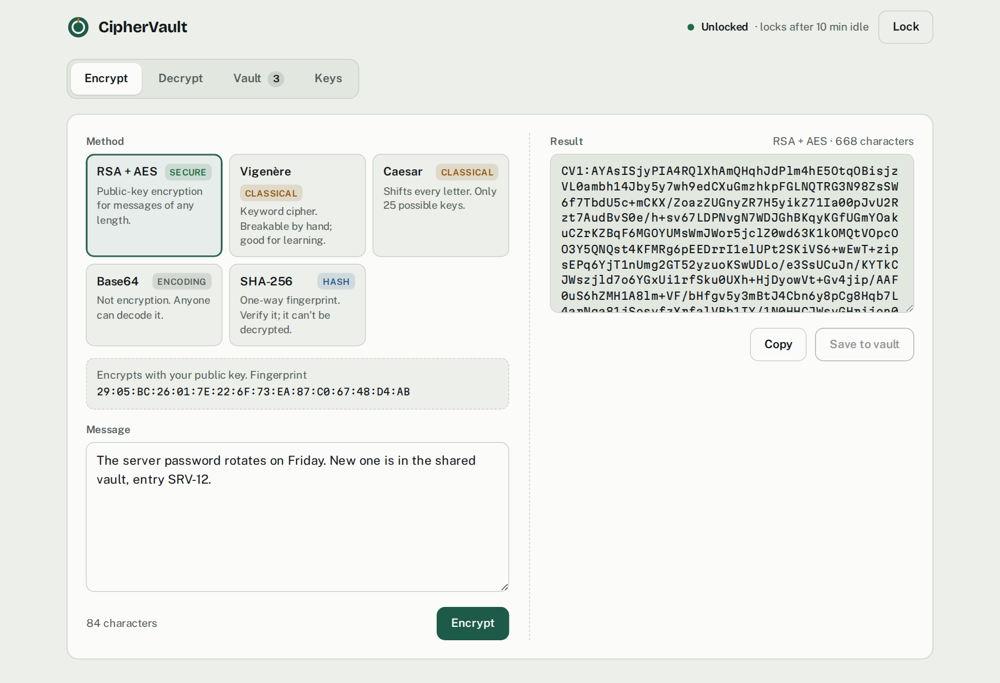
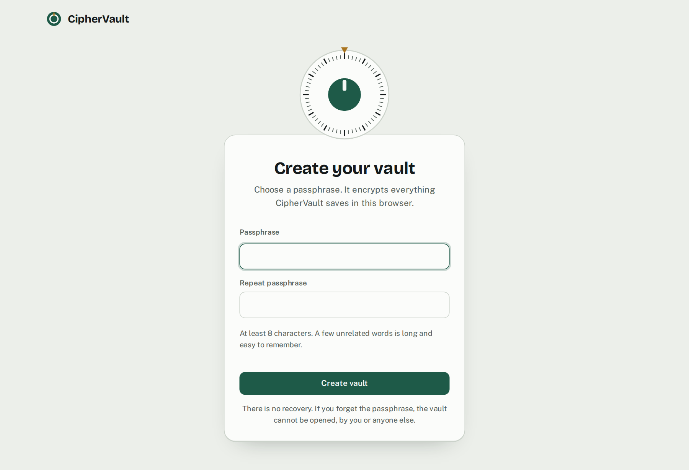
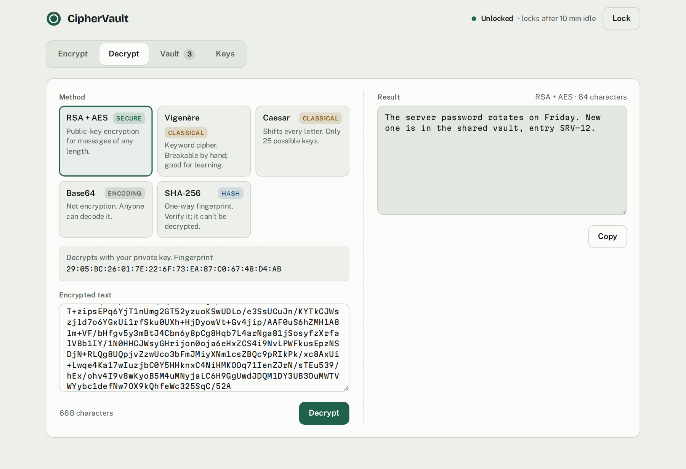
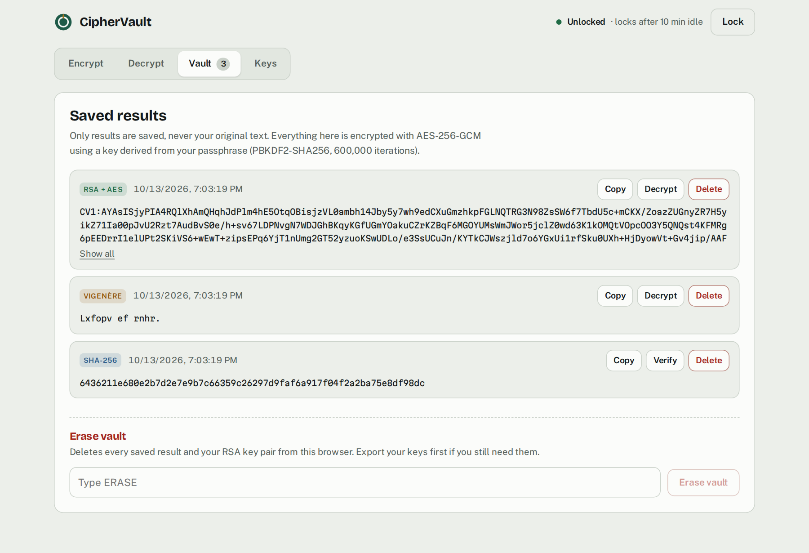
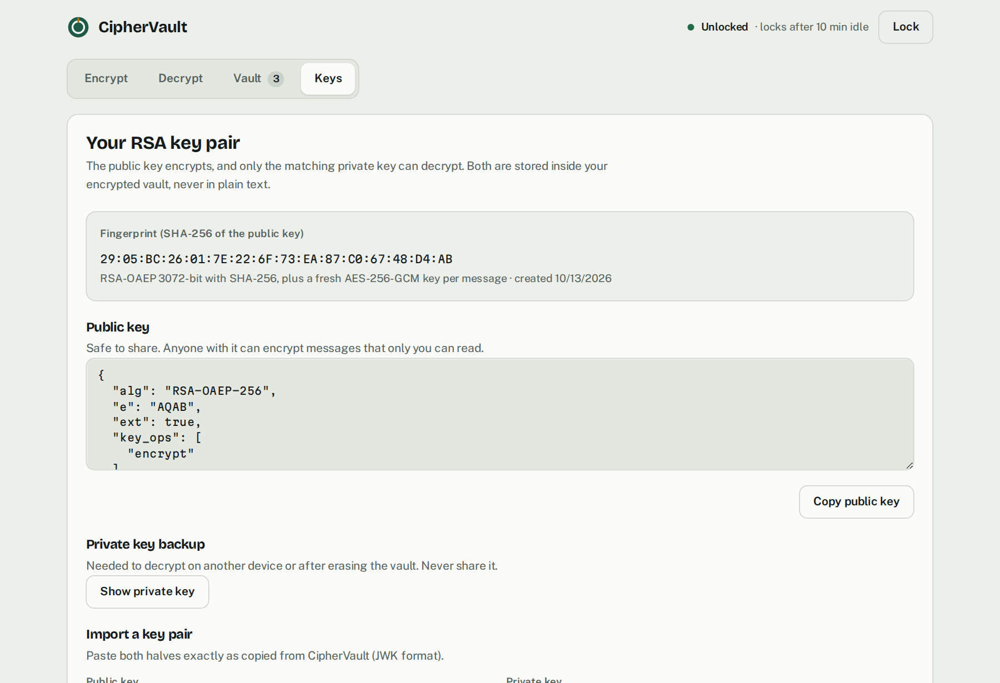
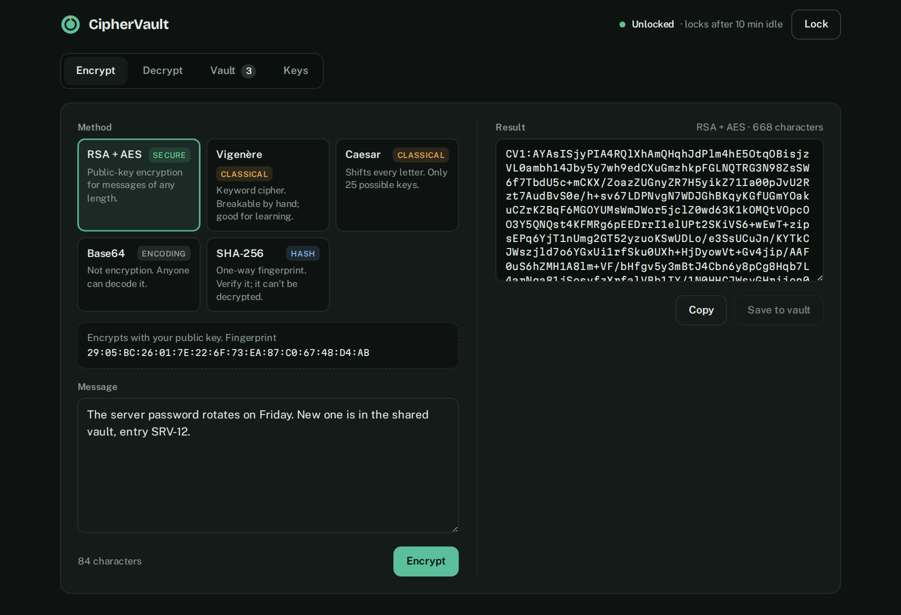

# CipherVault

[](https://github.com/CyberAhmedX/CipherVault/actions/workflows/tests.yml)

**Live demo: [cyberahmedx.github.io/CipherVault](https://cyberahmedx.github.io/CipherVault/)**

A browser-based encryption tool with a passphrase-protected vault. Encrypt messages with RSA + AES, compare it with classical ciphers, encodings and hashes, and keep results in an encrypted vault. Everything runs locally with the Web Crypto API: no server, no third-party scripts, no network requests.



## Features

- **RSA + AES (hybrid) encryption** for messages of any length, using your own 3072-bit RSA key pair
- **Classical ciphers** (Caesar, Vigenère), **Base64** encoding and **SHA-256** hashing, each labeled for what it really is: secure, classical, encoding or hash
- **SHA-256 verification:** check whether a text matches a hash
- **Encrypted vault:** saved results and your keys are encrypted with a key derived from your passphrase
- **Key management:** fingerprint, public key sharing, private key backup, import and regeneration
- Auto-locks after 10 minutes without activity, and works fully offline
- Light and dark mode that follows your system setting

## Security design

| Part | How it works |
| --- | --- |
| Vault encryption | AES-256-GCM. A fresh random 96-bit IV for every save, and GCM's tag rejects a wrong passphrase or tampered data |
| Passphrase to key | PBKDF2-HMAC-SHA256 with 600,000 iterations (OWASP 2023 guidance) and a random 128-bit salt. The derived key is non-extractable and lives only in memory while unlocked |
| What is stored | Only the encrypted vault blob in `localStorage`. The original text of a message is never saved |
| RSA + AES | Each message gets a new AES-256-GCM key. The message is encrypted with AES, and that key is encrypted with RSA-OAEP (SHA-256, 3072-bit). This removes RSA's size limit, the same approach PGP uses |
| Page hardening | A strict Content Security Policy allows only this folder's own scripts, styles and fonts, and blocks every network connection. Fonts are bundled, so nothing loads from a CDN |
| Output safety | All user and stored data is rendered with `textContent`, never as HTML |

### Security fixes from self-review

The first version of this project had problems I found and fixed while reviewing my own code:

- **Stored XSS** in the saved-messages view: data was rendered as HTML. Now everything is rendered as text.
- **Plaintext storage:** the original text of every message was saved unencrypted next to its "encrypted" form. Nothing is stored in plain text now.
- **Fake login:** the username and password were hardcoded in JavaScript and could be skipped from the browser console. They are replaced by a real passphrase that encrypts the vault.
- **Unencrypted private key:** the RSA private key was saved in plain `localStorage`. It is now kept only inside the encrypted vault.
- **Unused third-party script:** a crypto library was loaded from a CDN without being used, a supply-chain risk for no benefit. It is removed.

The same review fixed functional bugs: RSA failed on messages over about 190 bytes, Base64 broke on non-Latin text such as Urdu or emoji, Vigenère produced wrong results with digits in the key, Caesar broke on negative shifts, and Export Keys crashed before the first encryption.

## How to use

Try the [live demo](https://cyberahmedx.github.io/CipherVault/), or download the project and open `index.html` in a modern browser (Chrome, Edge, Firefox or Safari). No server or install is needed.

1. **Create your vault** by choosing a passphrase. There is no recovery if you forget it, by design.
2. **Encrypt:** pick a method, type a message and press Encrypt. Press **Save to vault** to keep the result.
3. **Decrypt:** paste the result, pick the same method and key, and press Decrypt. For SHA-256, paste the original text and the hash to verify them.
4. **Keys:** copy your public key to share it, and back up your private key somewhere safe, such as a password manager, so you can decrypt on another device.
5. Press **Lock** when you are done. The vault also locks itself after 10 idle minutes.



## Screenshots

**Decrypting with the private key**


**The vault: saved results, encrypted at rest**


**Key management: fingerprint, public key and private key backup**


**Dark mode**


## Upgrading from the first version

The first version stored saved messages and the RSA key pair in `localStorage` without encryption. When you create or unlock a vault, CipherVault moves those results and keys inside the encrypted vault and then deletes the unencrypted copies, including the original text of each message. Messages encrypted with the old RSA format can still be decrypted.

## Tests

GitHub Actions runs two sets of tests on every push.

**Crypto unit tests** (`tests/cipher.test.js`) run the exact `cipher.js` the page uses, on Node's built-in Web Crypto:

- SHA-256 against the official FIPS test vectors, and Caesar, Vigenère and Base64 against textbook examples, including Urdu and emoji
- RSA + AES round trips for messages far longer than RSA alone allows, with a 3072-bit key
- A changed ciphertext, a truncated message or the wrong private key is rejected, never decrypted
- The vault uses 600,000 PBKDF2 iterations, a fresh IV for every save, and a key that can't be exported
- A wrong passphrase, a different salt or tampered vault data can't open the vault

**Browser tests** (`tests/browser/`) open the real page in Chromium, Firefox and WebKit (Safari's engine) and click through it:

- Create a vault, encrypt, save, lock, fail with a wrong passphrase, unlock and decrypt
- Nothing readable is ever stored, not even the encrypted result outside the vault
- **Stored XSS regression:** an HTML payload saved to the vault is shown as text and never runs
- Plaintext left by the first version is moved into the vault and deleted
- The page makes no network requests outside its own folder

To run them yourself:

```bash
node --test                       # crypto unit tests, no install needed
npm ci && npx playwright install  # once, for the browser tests
npx playwright test
```

## Project structure

- `index.html`: page structure and the Content Security Policy
- `cipher.js`: all cryptography, as pure functions with no page access
- `app.js`: the interface, vault and key handling
- `style.css`: styles, with light and dark themes
- `fonts/`: bundled fonts and their licenses
- `tests/`: crypto unit tests and browser tests

## Limitations

- The vault lives in one browser. Clearing site data deletes it, so back up your private key.
- Anyone with access to your unlocked browser session can read the vault. Lock it when you step away.
- PBKDF2 slows down passphrase guessing but cannot stop it. A long passphrase matters.
- The live demo is served from `cyberahmedx.github.io`, the same site as my portfolio, so both share browser storage. It's for trying CipherVault out. For real secrets, download it and open `index.html` from your own computer.
- Caesar and Vigenère are included for learning. They are trivially breakable and should never protect real secrets.

## License

Released under the [MIT License](LICENSE). Fonts: Bricolage Grotesque, Public Sans and Martian Mono, each under the SIL Open Font License 1.1 (see `fonts/`).
